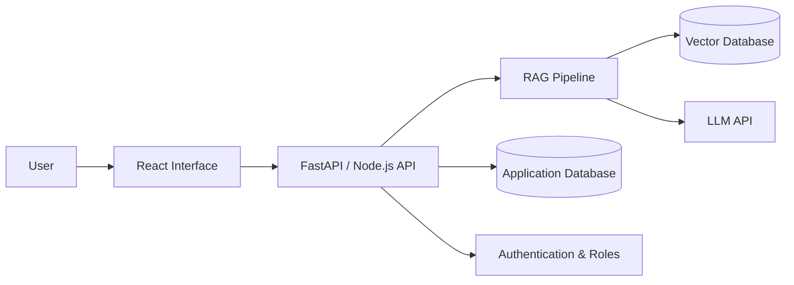

# Hailemichael Assefa

### Full-Stack Engineer

**Full-Stack Engineer building scalable web platforms, secure APIs, and AI-powered products.**

📍 Bishoftu, Oromiya, Ethiopia · Open to remote roles

[Portfolio]([PORTFOLIO_URL]) · [LinkedIn]([LINKEDIN_URL]) · [Email](mailto:[EMAIL]) · [CV]([CV_URL])

## What I Build

- Scalable full-stack web applications with React, Node.js, and Laravel
- E-commerce, marketplace, and government-service platforms
- Secure authentication, role-based access, and clean API design
- RAG chatbots, LLM-powered agents, and workflow automation
- ML prediction services and data-driven product features

## Technology Stack

| Area | Technologies |
|---|---|
| Frontend | React, Next.js, TypeScript, Tailwind CSS, Redux Toolkit |
| Backend | Node.js, Express, NestJS, Laravel, REST APIs, WebSockets |
| Databases | MongoDB, PostgreSQL, MySQL, Redis |
| AI / ML | Python, FastAPI, LangChain, RAG, Vector Databases, scikit-learn |
| DevOps | Docker, GitHub Actions, Vercel, Render, Nginx |

## Featured Projects

### [HeritageHub — Ethiopian Cultural-Products E-Commerce]([REPO_URL])

- **Problem:** Make Ethiopian cultural products easier to discover through a focused online shopping experience.
- **Solution:** An e-commerce platform concept centered on cultural-product discovery and shopping.
- **Tech stack:** [Add verified project technologies]
- **Key features:** Product discovery, catalog browsing, and an e-commerce shopping journey.
- **Architecture highlights:** Keep storefront browsing, product catalog, and commerce flows organized as distinct application concerns.
- **Links:** [Live Demo]([LIVE_DEMO_URL]) · [Source Code]([REPO_URL]) · [API Docs]([API_DOCS_URL])

### [Auto Car Market — Automotive Marketplace]([REPO_URL])

- **Problem:** Bring vehicle discovery and seller inquiries together in a focused marketplace experience.
- **Solution:** A marketplace concept covering dealer onboarding, vehicle search, image uploads, and inquiry management.
- **Tech stack:** [Add verified project technologies]
- **Key features:** Dealer onboarding, vehicle search, vehicle image uploads, and inquiry management.
- **Architecture highlights:** Separate dealer and vehicle workflows from search and inquiry handling, with controlled image-upload flows.
- **Links:** [Live Demo]([LIVE_DEMO_URL]) · [Source Code]([REPO_URL]) · [API Docs]([API_DOCS_URL])

### [Government Service Automation — Public-Service Workflow Platform]([REPO_URL])

- **Problem:** Make public-service requests and their progress easier to manage digitally.
- **Solution:** A digital workflow platform concept for submitting documents and tracking service status with role-based access.
- **Tech stack:** [Add verified project technologies]
- **Key features:** Role-based access, document uploads, and request status tracking.
- **Architecture highlights:** Model service requests as trackable workflows and protect actions according to user roles.
- **Links:** [Live Demo]([LIVE_DEMO_URL]) · [Source Code]([REPO_URL]) · [API Docs]([API_DOCS_URL])

## AI Engineering Lab

I build practical AI systems for customer support, public-service automation, and intelligent workflow tools.

<!-- AI_LAB_START -->
| Project | Focus | Stack | Status | Links |
|---|---|---|---|---|
| **Government Service RAG Chatbot** | RAG · Citations · Document Search | RAG, Citations, Document Search | Status to be updated | — |
| **Financial Support AI Agent** | LLM Agent · Workflow Automation | LLM Agent, Workflow Automation | Status to be updated | — |
| **Medical Risk Prediction API** | ML API · Model Evaluation | ML API, Model Evaluation | Status to be updated | — |
<!-- AI_LAB_END -->

### Reference Architecture

### AI Capabilities

- Retrieval-Augmented Generation with document citations
- LLM-powered chatbots and customer-support agents
- Intelligent document search and workflow automation
- ML prediction APIs with FastAPI
- Secure API design, validation, logging, and deployment

## Dynamic Activity Stats

## 📈 Dynamic GitHub Activity Graphs

### 📊 Recent Contribution Activity

### 🎞️ Animated Contribution Graph

<!-- BEGIN ACTIVITY-GRAPH -->
<!-- END ACTIVITY-GRAPH -->

## Optional Recent GitHub Activity

<!--START_SECTION:activity-->
<!--END_SECTION:activity-->

## 🌍 Visitor Activity

Anonymous, aggregated visitor-location data only. No visitor identities are shown.

## Achievements

- **Certifications:** [Add verified certifications, if applicable]
- **Recognition:** [Add verified awards or milestones, if applicable]
- **Selected work:** [Add verified project outcomes or contributions, if applicable]

## Contact

Interested in building useful web and AI products together? I’m open to remote full-stack, AI integration, and software engineering roles.

- **Portfolio:** [PORTFOLIO_URL]
- **LinkedIn:** [LINKEDIN_URL]
- **Email:** [EMAIL]
- **Open to work:** Remote full-stack engineering, AI integration, and software engineering opportunities
