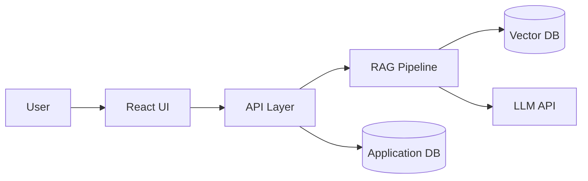

# 👋 Hailemichael Assefa

**Building scalable web platforms and practical AI-powered products.**

## ⚡ About Me

- 🔭 Currently building: **RAG-powered government-service chatbot**
- 🌱 Learning: **Advanced system design and AI engineering**
- 💬 Ask me about: **React, Node.js, Laravel, MongoDB, RAG, API design**
- 🌍 Based in: **Ethiopia · Open to remote work**

## 🧰 Tech Stack

## 🚀 Featured Projects

| Project | Description | Stack | Links |
|---|---|---|---|
| **HeritageHub** | Ethiopian cultural-products e-commerce platform | React · Node.js · MongoDB | [Demo](#) · [Code](#) |
| **Auto Car Market** | Automotive marketplace with dealer workflows | React · Node.js · MongoDB | [Demo](#) · [Code](#) |
| **Gov RAG Chatbot** | Document-grounded AI assistant with citations | React · FastAPI · LangChain | [Demo](#) · [Code](#) |
| **Medical Risk API** | ML prediction service with REST API | Python · FastAPI · scikit-learn | [Code](#) |

## 🤖 AI Engineering Lab

**Focus areas:** RAG, LLM agents, document automation, ML APIs, and secure backend systems.

## 📊 Activity

## 🤝 Connect

[Portfolio](https://your-portfolio.com) · [LinkedIn](https://linkedin.com/in/your-username) · [Email](mailto:your@email.com)

